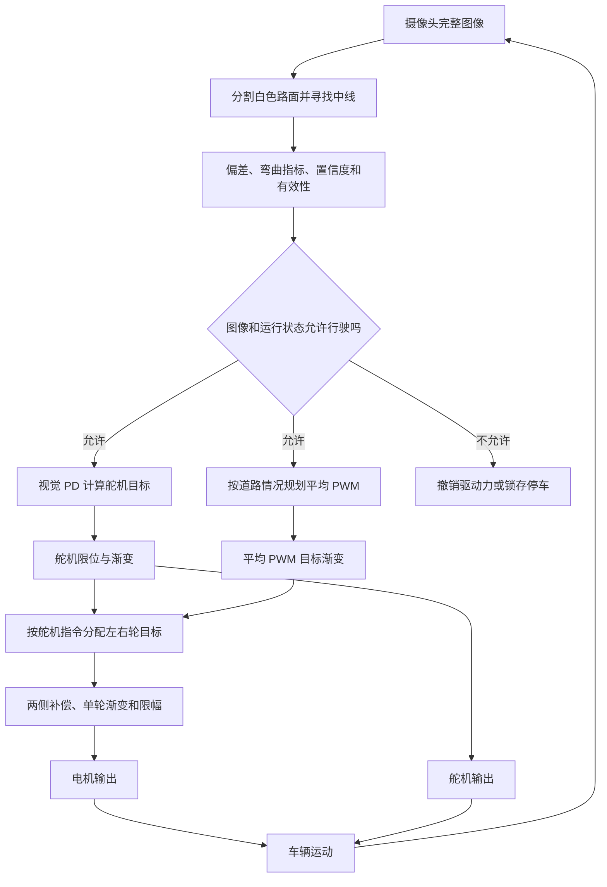

# 新的循迹与速度、转向控制思路

本文根据当前 `D:\tc264debug\patrol_no encoder` 的源码编写，说明默认 `CAR_VISION_ONLY=1` 时智能车如何工作。重点是理解控制过程；逐文件修改清单和验证记录见 [无编码器视觉循迹修改报告](无编码器视觉循迹修改报告.md)。

## 1. 总体思路：看道路决定方向和驱动力

编码器损坏后，程序仍能从摄像头判断道路在哪里、向哪边弯，以及当前图像是否可靠。因此，新的方案把控制分成两部分：

- **方向控制**：摄像头不断测量道路中心偏差，PD 算法据此调整舵机，车辆运动后的新图像再反馈给控制器。
- **驱动力控制**：根据道路偏差、弯曲程度和图像置信度规划电机 PWM，再经过渐变、左右轮分配和限幅后输出。

方向仍有视觉反馈闭环；电机没有实际轮速反馈，属于开环驱动。本文说的“减速”是降低驱动 PWM 的控制意图，实际车速还受电池电压、负载、地面和惯性影响。当前程序没有使用光流估计速度，也不能保证恒定的米/秒车速。



## 2. 第一步：从图像中找到可以走的道路

### 2.1 用亮度区分路面与背景

摄像头输出的是 188×120 灰度图。当前算法针对“较暗背景上的白色宽路面”，利用亮度差找路，不直接识别蓝色色相。

默认关注图像约第 32～111 行，避开过远背景和车头区域。程序对该区域采样，利用大津法划分明暗两类，再取两类平均亮度的中点作为阈值，并对阈值进行平滑。

像素亮度超过阈值，就被当作亮色候选区域。如果明暗对比度不足，程序不会把这帧当作可靠的行驶依据。

### 2.2 逐行寻找左右边界和中点

实际道路搜索从下向上，每隔两行处理一行，当前扫描的是第 111、109……33 行，共 40 行。

在每一行中，程序寻找连续的亮色区域，并检查它的宽度以及它与上一行道路位置的连续性。对于左右边界都看得见的路段：

```text
道路中心 x = (左边界 x + 右边界 x) / 2
这一行的偏差 = 道路中心 x − 图像中心 x
图像中心 x = 94
```

例如，某行道路中心在 114，则这一行的偏差为 `114 − 94 = +20` 像素，表示道路在画面右边；中心在 74，则偏差为 −20，表示道路在左边。

程序还会连接路面内部不超过 3 像素的窄暗缝，避免一条细缝把道路错误分成两条。若单侧边界超出画面，只允许使用近期同一行的已测路宽估计中心，路宽记忆超过 5 帧会失效；估计点对置信度的贡献低于实测点。

道路突然变宽、出现多个候选区域等情况会参与歧义判断。纯视觉模式没有自动选岔路功能，不能把一片白色区域随意当成可通行路线。

### 2.3 融合近、中、远三个区域

只盯车前很近的位置，可能来不及转弯；只盯远方，又可能忽略车身已经偏离道路。因此，程序分别统计近、中、远区域的平均偏差：

| 区域 | 当前参与扫描的行 | 作用 | 权重 |
|---|---|---|---:|
| 近处 | 87～111，奇数行 | 观察车前道路位置 | 3 |
| 中间 | 61～85，奇数行 | 提供主要循迹参考 | 4 |
| 远处 | 33～59，奇数行 | 反映前方道路走向 | 3 |

当三个区域都有足够有效行时：

```text
综合像素偏差 = (3 × 近处偏差 + 4 × 中间偏差 + 3 × 远处偏差) / 10
err_norm = 综合像素偏差 × 1000 / 94
```

源码使用整数运算，会有截断。某个区域有效行少于 3 时，该区域不参与加权，并使用剩余区域的权重重新求平均。

`err_norm` 的符号决定转向方向：正值表示道路偏右，负值表示道路偏左。控制器再令 `e = err_norm / 1000`，并把 `e` 限制在 −1～1。

### 2.4 同时评估弯曲程度和可信程度

弯曲指标来自不同距离处的中线变化：

```text
bend_norm = clamp(
    (abs(中间偏差 − 近处偏差) + abs(远处偏差 − 中间偏差)) × 1000 / 94,
    0, 1000)
```

三个区域的偏差接近时，`bend_norm` 较小；越往远处偏差变化越明显，指标通常越大。它是图像中的变化程度，不是实际道路以米为单位的曲率。

有效性和置信度是两个不同判断。当前有效性要求：近处至少 5 行、中间至少 4 行、总计至少 12 行有效，其中至少 6 行为实测边界。置信度则综合有效行数量和实测/估计点比例，实测行按 100 分、估计行按 50 分贡献，再除以总扫描行数 40。

因此，一帧图像可能满足基本有效性，但置信度仍较低；这种情况允许继续循迹，却会降低 PWM 目标。

对应源码：`user/car_image.c` → `car_image_process_gray()`。

## 3. 第二步：根据视觉偏差控制转向

### 3.1 P 项处理当前偏差

比例项直接根据当前误差给出转向修正：

```text
P = Kp × e
Kp = 150
```

道路越偏右，右转修正越大；道路越偏左，左转修正越大。假设 `e=0.4`，P 项为 `150×0.4=60 μs`。

### 3.2 D 项处理偏差变化趋势

只使用 P 项时，车辆可能在道路两侧来回修正。D 项观察误差正在怎样变化，让转向指令同时考虑变化趋势：

```text
原始变化率 d = (本帧 e − 上帧 e) / 帧间隔秒数
滤波变化率 = 上次滤波值 + 0.25 × (d − 上次滤波值)
D = Kd × 滤波变化率
Kd = 6
```

例如，道路右偏且偏差还在增加时，D 项会增加向右的修正；如果偏差已经迅速缩小，D 项会减弱该方向的修正。参数合适时可以改善响应并减少摆动，但增益过大也会放大图像噪声。

帧间隔使用图像采集完成时间计算，并限制在 5～150 ms。首帧不计算误差突变；丢线后清除微分历史；重复时间戳不重复更新 PD。

### 3.3 转成舵机脉宽，再限制变化速度

```text
舵机目标脉宽 = 1540 + CAR_SERVO_SIGN × (P + D)
目标脉宽范围 = 1340～1740 μs
每 10 ms 指令变化不超过 12 μs
```

默认 `CAR_SERVO_SIGN=1`。假设误差稳定为 `e=0.4`，D 项已衰减到零，则目标脉宽为 `1540+60=1600 μs`。实际输出会分几个控制周期逐渐靠近该目标。

这里的“舵机脉宽”是发送给舵机的指令，没有舵角传感器证明车轮已到达指定角度。应在架空检查时确认：画面道路偏右，实际车轮也向右；若相反，应调整方向配置。中位和左右限位也需要按机械结构校准。

对应源码：`user/car_pid.c` → `car_pid_steering_step()`；`user/car_control.c` → `car_control_tick()`。

## 4. 第三步：根据道路情况调节电机 PWM

### 4.1 为什么不再使用速度 PI

旧速度 PI 需要真实轮速反馈。编码器损坏后计数可能一直是零，即使车轮在转，程序仍会认为速度不足，导致积分累积、PWM 不断增加，或错误触发堵转停车。

新模式直接停止使用这套反馈计算。它不初始化或读取编码器，也不根据零计数补偿动力。

### 4.2 从偏差和弯曲程度得到平均 PWM 目标

程序先计算道路需要谨慎行驶的程度：

```text
severity = clamp(1.3 × abs(e) + bend_norm / 650, 0, 1)
平均 PWM 目标 = 1100 − (1100 − 800) × severity
```

`clamp(x, a, b)` 表示把数值限制在 a～b 之间。这里同时考虑：

- 当前偏差很大：车辆需要先回到合适位置，减少驱动力有利于留出纠偏时间。
- 前方中线变化明显：提前降低驱动力，减轻进入弯道时的控制压力。

在有效、无歧义且置信度充足的图像下，几个例子如下：

| 场景 | `e` | `bend_norm` | `severity` | 平均 PWM 目标 |
|---|---:|---:|---:|---:|
| 居中的直道 | 0 | 0 | 0 | 1100 |
| 道路整体偏右 | 0.4 | 0 | 0.52 | 944 |
| 偏差小、前方明显弯曲 | 0 | 325 | 0.5 | 950 |
| 偏差大且弯曲明显 | 0.8 | 500 | 1（限幅后） | 800 |

左右偏差使用绝对值参与 PWM 规划，因此同样程度的左偏与右偏，平均驱动力目标一致。

### 4.3 图像不够可靠时进一步降低目标

当 `confidence<65`，或 `far_rows<3` 时，平均 PWM 目标最多为 650。前者表示整体识别可靠度不足，后者表示看得足够远的道路信息不够。

这些数值的满量程是 10000：1100 对应 11%，800 对应 8%，650 对应 6.5% 占空比。相同占空比在不同电压或地面条件下不会产生相同车速。

对应源码：`user/car_turn.c` → `car_turn_plan()`；参数见 `user/car_config.h`。

## 5. 第四步：让电机输出平稳，并配合转弯

### 5.1 平均目标先渐变

图像给出的是“希望达到的平均 PWM”。每 10 ms 的控制中断将当前平均目标向它靠近：每次最多增加 10，正常减小最多 40。

例如，从零向 1100 上升，在目标保持不变、直行且默认补偿的情况下，约需要 110 个控制周期，也就是 1.1 秒。这个时间描述的是指令上升过程，不代表车辆在 1.1 秒内达到某个实际速度。

### 5.2 根据舵机指令分配左右轮目标

右转时，左后轮在外侧，代码给左侧更大的 PWM 目标；左转时相反。程序先将当前输出舵机脉宽相对于中位的偏移归一化为 −1～1，再乘以 0.15，得到差速系数 `r`：

```text
左轮目标 = 当前平均目标 × (1 + r)
右轮目标 = 当前平均目标 × (1 − r)
```

默认方向配置下，向右对应 `r>0`，向左对应 `r<0`。使用经过渐变后的舵机指令，使左右轮分配跟随当前转向指令变化。

沿用前面的稳定右偏例子：`e=0.4`、`bend_norm=0`、D 项为零，舵机指令稳定到 1600 μs，平均 PWM 稳定到 944：

```text
归一化转向 = (1600 − 1540) / (1740 − 1540) = 0.3
r = 0.3 × 0.15 = 0.045
左轮目标 = 944 × 1.045 = 986.48
右轮目标 = 944 × 0.955 = 901.52
```

最终输出取整数，还会受下面的渐变和限幅影响。左右轮数值不同是驱动力分配，并不保证两侧实际轮速精确满足该比例。

### 5.3 每个电机再执行补偿、渐变和硬限幅

两侧默认补偿系数均为 1.0，可用于调整电机的稳定差异。之后对每个电机分别处理：

```text
期望输出 = clamp(该侧目标 × 该侧补偿系数, 0, 1500)
本次输出 = 上次输出 + clamp(期望输出 − 上次输出, -40, +10)
最终输出再次限制在 0～1500，并转成整数
```

平均目标渐变用于平滑整体驱动力，单轮渐变用于限制差速或补偿引起的额外变化。因此，左右轮分配也不能使某一侧突然大幅增加输出；最终单轮上限为 15% 占空比。

丢线、停车等情况直接撤销 PWM，不等待正常减小的渐变过程。零输出表示撤销驱动力，当前驱动接口下可能滑行，车辆不会因此瞬间停止。

对应源码：`user/car_turn.c` → `car_turn_wheel_targets()`；`user/car_control.c` → `open_pwm_step()`。

## 6. 图像处理和电机控制为什么分开运行

图像帧率会受到采集、处理和屏幕刷新的影响，不能假设它总是固定的。当前程序使用两个节奏：

| 执行位置 | 触发条件 | 主要工作 |
|---|---|---|
| 主循环 | 取得新的完整图像帧 | 复制快照、提取道路、计算 PD 和平均 PWM 计划、更新状态 |
| 定时中断 | 每 10 ms | 检查停止按键与图像超时、渐变目标、分配左右轮、输出 PWM 和舵机脉宽 |

主循环先复制完成的图像，再释放下一帧采集；识别和显示使用同一份快照，避免正在分析的图像被采集过程改写。屏幕最多每 200 ms 刷新一次，但控制中断按 10 ms 调度。

没有新图像的短时间内，控制中断继续使用最近的计划；超过 150 ms 未取得新图像，则锁存停车。这也说明为什么不能把图像超时限制随意加大：计划越旧，越可能不能反映车辆前方道路。

主要调用关系如下：

```text
主循环 cpu0_main.c
  → car_image_process_gray()：图像 → 道路信息
  → car_board_vision()
  → car_control_vision()：检查图像与状态
  → car_turn_plan()：转向目标 + 平均 PWM 计划

10 ms 中断 isr.c
  → car_board_tick()：检测按键4
  → car_control_tick()：超时检查、渐变、差速、限幅
  → outputs()：写入电机和舵机 PWM
```

## 7. 启停、丢线和恢复时的行为

| 状态或事件 | 当前程序行为 |
|---|---|
| 上电 | 初始化输出，但电机 PWM 为零 |
| 连续至少 3 帧有效且无岔路歧义 | 具备启动条件，仍需按键3 |
| 按键3成功启动 | 等下一帧有效图像，再从零逐步建立驱动力 |
| 单帧无效或无法处理的岔路 | 平均计划置零，下一次控制调度将 PWM 清零，保持已有转向目标 |
| 临时丢线恢复，尚未触发锁存故障 | 重置后的转向微分重新建立，PWM 从零渐变恢复 |
| 连续 3 帧丢线 | 锁存图像故障，保持停止 |
| 连续 3 帧岔路歧义 | 锁存岔路故障，保持停止 |
| 超过 150 ms 无新图像 | 锁存图像故障，撤销驱动力 |
| 按键4 | 中断直接检测停车 |
| 锁存故障后画面恢复 | 不自动开走；重新满足图像条件后需按键3 |

单帧不可用时仍保留转向目标，舵机输出可能继续向此前目标渐变；锁存停车时则将转向目标设为当前输出脉宽。这样不会在故障时突然强制回正。

纯视觉模式不依赖 IMU，也停用了原先依据累计转角执行的“圆环绕一圈再出环”流程。普通清晰弯道可按中线跟随，出现无法判断去向的岔口则停车。本版本没有新增纯视觉圈数判断或出口识别。

## 8. 调试时先看什么、再调什么

1. **先确认图像。** 道路中线应落在白色路面内；先处理曝光、安装角度和反光问题，再调整控制参数。
2. **确认转向方向与机械中位。** 架空观察画面右偏时车轮是否右转；校准 `CAR_SERVO_SIGN`、中位和限位。
3. **用低 PWM 确认前进方向和起步能力。** 直道、弯道、低置信度的 1100/800/650 是初始值，不是实测最佳值；调参时保留最终上限。
4. **整定转向。** 在低驱动力下观察纠偏是否及时；先理解 P 对误差的作用，再少量调整 D，观察是否改善摆动。不要同时大幅改变多个参数。
5. **检查左右差异。** 有稳定偏差时先排查机械与舵机中位，再考虑小幅调整两侧 PWM 补偿。单电机配机械差速器时，应核对接口并将软件差速比例设为 0。
6. **验证停车。** 检查按键4、遮挡相机、道路丢失以及图像恢复后不会自动重启等行为。

串口中的 `e`、`bend`、`q` 分别帮助判断偏差、弯曲程度和置信度；`duty_target` 是当前渐变后的平均 PWM 目标，`pwm` 是两侧输出，`us` 是舵机指令脉宽。`speed:NA` 表示没有可用的实际车速测量。

由于没有轮速反馈，本版本不能可靠判断电机是否堵转，也不能把增加 PWM 当作准确的加速量。当前软件已通过主机测试，完整 ADS 目标编译、烧录和实车验证仍需完成。实际修改目录为 `D:\tc264debug\patrol_no encoder`；此前检查到 IDE 中同名工程指向 `D:\tc264\patrol_no encoder`，使用前应核对工程属性中的 Location。
